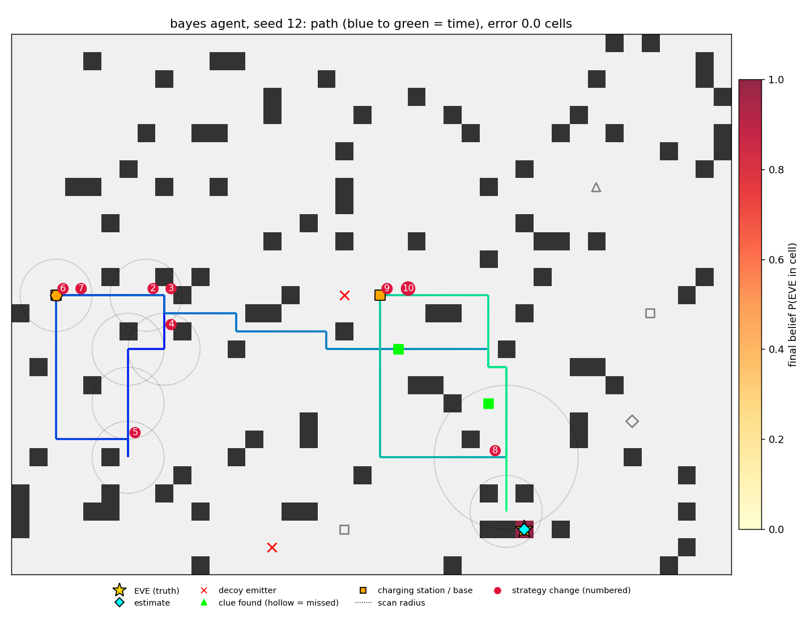
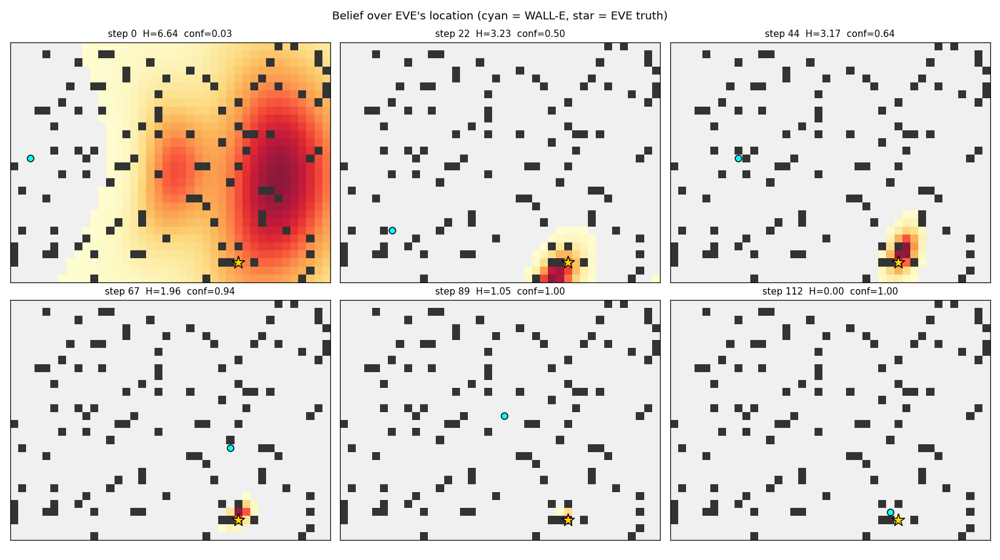
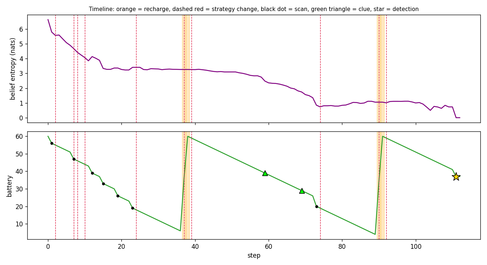
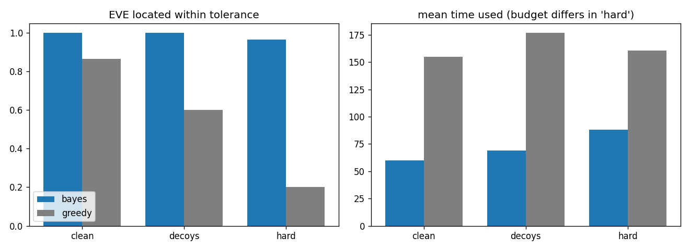

# WALL-E and EVE's Signal

An autonomous agent that explores a simulated, partially observable world, gathers clues, manages a limited battery and time budget, and works out **where EVE is, what state she is in, and what WALL-E should do next**.

The agent keeps a Bayesian belief over EVE's location and status, chooses actions by *expected information gain per unit cost*, always keeps enough battery to get home, and logs every decision with its reasoning.



## Quick start

```bash
pip install -r requirements.txt

# one mission: trace, report, ASCII map and plots go to outputs/
python -m walle_eve.run --config configs/sample.yaml --out outputs

# same mission with the greedy baseline, or a different seed
python -m walle_eve.run --config configs/sample.yaml --agent greedy
python -m walle_eve.run --config configs/sample.yaml --seed 3

# a harder mission (more decoys, noisier sensors, tighter budgets)
python -m walle_eve.run --config configs/hard.yaml --out outputs/hard

# benchmark over random missions (about 10 s per seed on one core)
python -m walle_eve.benchmark --seeds 30 --out outputs

# tests
pip install -r requirements-dev.txt && pytest -q
```

Python 3.10+. Dependencies: numpy, matplotlib, pyyaml.

## How it works

### Environment (`walle_eve/env.py`)

A 40x30 grid with random walls, a base, and charging stations. From the config and seed it hides:

- **EVE**: a position and a status (`active` or `dormant`). A dormant EVE emits a much weaker signal, so a faint reading is ambiguous between "far away" and "close but dormant".
- **Clues** (6 by default), revealed only by getting close to them:
  - `tracks`: a noisy bearing towards EVE
  - `debris`: a noisy range to EVE
  - `log`: a status report that is wrong 15% of the time
- **Decoys**: spoofed emitters that make some readings point at the wrong place.

Every action returns an observation:

| action | cost (default) | observation |
|---|---|---|
| `move` to a neighbouring cell | 1 battery, 1 time | noisy passive signal reading; clues within 1 cell |
| `scan(r)` | 2 + r battery, 2 time | low-noise reading; clues within `r`; detects EVE within `r` with probability 0.9 |
| `recharge` (at a station) | +30 battery, 6 time | none |

A signal reading is a **bearing and a strength**. Strength falls off as `A * gain[status] / (1 + (d/d0)^2)`. Both channels carry Gaussian noise, and part of that noise is a fixed per-cell bias (think multipath), so re-scanning the same cell does not average the error away. With probability `decoy_prob`, a reading comes from a decoy instead of EVE.

### Agent (`walle_eve/agent.py`, `belief.py`, `planner.py`)

1. **Belief.** A joint distribution over `(status, cell)`. Each observation is converted to a likelihood and multiplied in (Bayes rule):
   - signal readings: log-normal in strength x von Mises in bearing, mixed with a uniform outlier term so spoofed readings are down-weighted instead of dragging the estimate away
   - clues: bearing, range or status likelihoods
   - scans that find nothing: cells inside the radius are down-weighted; a detection collapses the belief
2. **Planning.** Candidates are `(target cell, scan radius)`. For each feasible candidate, Monte-Carlo (common random numbers) estimates the expected entropy reduction of a scan there. Candidates are ranked by `gain / (time/T + battery/B)`, with travel included in the cost. Two small bonuses are added to the gain: a chance-of-finding-EVE term, and a novelty term that values unexplored ground because clues are invisible to the entropy calculation.
3. **Battery rule ("turn back").** A candidate is feasible only if, after travelling and scanning, WALL-E can still reach a charging station with `reserve` battery left. At a station, the agent compares "go now" against "recharge first" and picks whichever has the better score, so it recharges when that unlocks a better, longer-range scan. When nothing affordable is left it turns back, recharges, and continues.
4. **Replanning.** A new plan is made on a new clue, a significant change in belief entropy, plan completion, every 5 steps, or a safety check. Changes of mode (explore, return, recharge) or a retarget of more than 6 cells are logged as **strategy changes**.
5. **Stopping.** The agent concludes when it has detected EVE and the posterior is concentrated, when no scan is expected to help, or when budgets run out.

### Greedy baseline

Has no belief. It inverts the latest reading into a point estimate (assuming an *active* EVE), walks towards it, scans when close, recharges to full at stations, and follows the same battery-safety rule. It exists to show what the Bayesian machinery buys.

## Config format

Missions are YAML or JSON. See [`configs/sample.yaml`](configs/sample.yaml), which documents every field. Anything omitted falls back to the defaults in `walle_eve/config.py`.

| section | what it defines |
|---|---|
| `seed` | map, hidden EVE, clue placement and content, decoys, sensor noise |
| `map` | size, wall density, base, charging stations |
| `eve` | hidden position and status (or `null` to draw from the seed) and the agent's status prior |
| `initial_signal` | first reading: `bearing_deg`, `strength`, `timestamp` (`mode: explicit`), or `auto` to draw it |
| `resources` | battery capacity, time budget, reserve, per-action costs |
| `clues` | count, type mix, clue noise |
| `sensors` | signal model, noise, decoys, detection probability |
| `agent` | agent type (`bayes` or `greedy`), scan radii, thresholds |

The agent is told the map, budgets, costs, sensor characteristics and the initial signal. It must learn EVE's location, status and the clue locations **only through interaction**.

## Outputs

| file | content |
|---|---|
| `outputs/sample_trace.jsonl` | one JSON record per step: action, observation, belief summary (map cell, entropy, confidence, status, top modes), decision (target, expected gain, trigger, alternatives), reasoning string, strategy-change flag, plus a `debug_truth` field for analysis that the agent never sees |
| `outputs/sample_report.md` | final mission report: evidence, inferred location and status, confidence, strategy changes, recommended next step, ground-truth check |
| `outputs/path.png`, `path_ascii.txt` | path, scans, clues, decoys, EVE and final belief |
| `outputs/belief_evolution.png` | belief snapshots across the mission |
| `outputs/timeline.png` | entropy and battery over time with recharges, clues and strategy changes |
| `outputs/*_greedy.*` | the same mission run by the baseline |
| `outputs/benchmark.*` | benchmark table, CSV and chart |

Example trace line (abridged):

```json
{"step": 1, "pos": [2, 15], "action": {"type": "scan", "radius": 2},
 "belief": {"map_cell": [37, 8], "entropy": 5.798, "confidence": 0.092, "status": {"active": 0.732, "dormant": 0.268}},
 "reasoning": "Belief peak (33, 12) (conf 0.03, entropy 6.64 nats, P(active)=0.74, P(dormant)=0.26). Best information per cost: scan r=2 at (2, 15) (expected gain 0.83 nats, travel 0, score 11.1). Battery margin after action: 56 above return+reserve."}
```

## Results

### Sample mission (`configs/sample.yaml`, seed 12; EVE is dormant)

| | location error | status | steps | scans | recharges |
|---|---|---|---|---|---|
| Bayesian agent | 0 cells | dormant (correct) | 112 | 8 | 4 |
| Greedy baseline | 10 cells | active (wrong) | 198 | 2 | 8 |

The greedy agent reads the weak signal of a dormant EVE as "far away" and keeps heading the wrong way. The Bayesian agent keeps both explanations alive until bearings from different places and two range clues settle it. Its report also flags readings that its final estimate cannot explain: 17 spoofed readings were received and all 17 were flagged, with one false alarm.




### Benchmark: 30 random missions per cell

Each seed draws a new map, EVE position and status, clues and decoys. `hard` uses 30% spoofed readings, 4 decoys, noisier sensors and tighter budgets (50 battery, 180 time).

| condition | agent | location correct | status correct | found by scan | median error (cells) | mean time used | mean battery used |
|---|---|---|---|---|---|---|---|
| clean | bayes | 100% | 100% | 97% | 0.0 | 60 | 64 |
| clean | greedy | 87% | 87% | 60% | 0.0 | 155 | 134 |
| decoys | bayes | 100% | 100% | 93% | 0.0 | 69 | 73 |
| decoys | greedy | 60% | 70% | 37% | 2.5 | 177 | 146 |
| hard | bayes | 97% | 100% | 73% | 0.0 | 88 | 91 |
| hard | greedy | 20% | 63% | 17% | 5.8 | 161 | 128 |



Reproduce with `python -m walle_eve.benchmark --seeds 30`.

## Bonus features

- **Visualisation**: ASCII map, path and belief heatmap, belief evolution, timeline with strategy changes.
- **Decoy and spoofed signals**: handled in the likelihood, with a post-mission spoof check in the report.
- **Noisy sensors**: Gaussian noise plus a per-cell bias, with a noisier passive channel.
- **Generalisation benchmark** across random missions and difficulty levels.
- **Classical baseline** (greedy) for comparison.

Not done: multi-agent coordination, an LLM planner comparison, and a Gazebo/Webots physics simulation.

## Limitations

- **The agent's sensor model equals the simulator's.** It is told the true noise levels and signal law, so the benchmark measures planning and inference, not robustness to a mis-specified model. The `assumed_outlier_prob` setting is the one place the two can differ, and varying it is an easy experiment.
- **EVE is static** and the world is a 2D grid with 4-connected movement. Signals pass through walls.
- **The planner is heuristic.** It is greedy (one scan lookahead), uses 6 Monte-Carlo samples per candidate, and the `find_bonus` and `clue_bonus` terms are hand-tuned. Clue value in particular is only a proxy.
- **Repeated scans of one cell** are down-weighted by a hand-set penalty rather than modelled exactly.
- **Benchmark scope.** 30 seeds per cell is enough to show the gap with the baseline but not to rank close variants. The `bayes` 97% in the hard condition has a wide error bar.
- **The greedy baseline is deliberately simple.** A better hand-written heuristic (for example, one that averages readings) would narrow the gap.

## Ideas for extension

- Moving EVE: add a motion model and a diffusion step to the belief.
- Mis-specified sensor model: perturb the agent's assumed noise relative to the simulator.
- LLM planner: implement the `rank()` interface of `InfoPlanner` with an LLM that proposes `(target, radius)` and compare it with the information-gain planner.
- Multi-agent: several robots sharing one belief, with a coordinator allocating scan targets.

## Layout

```
walle-eve/
  README.md
  configs/            sample.yaml  hard.yaml
  walle_eve/
    env.py            simulated world, sensors, budgets
    belief.py         Bayesian belief and likelihoods
    planner.py        expected-information-gain planner
    agent.py          Bayesian agent and greedy baseline
    run.py            mission loop, trace logging, CLI
    report.py         final mission report
    viz.py            ASCII and matplotlib visualisation
    benchmark.py      random-mission benchmark
    grid.py config.py
  tests/
  outputs/            sample trace, report, plots, benchmark results
```

## License

MIT. Add your name in `LICENSE`.
